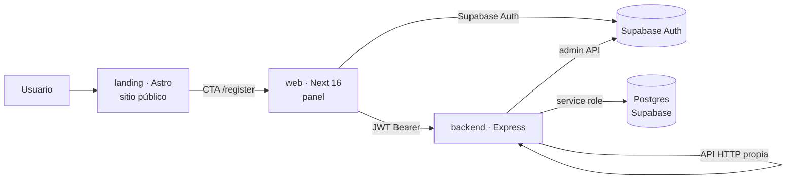
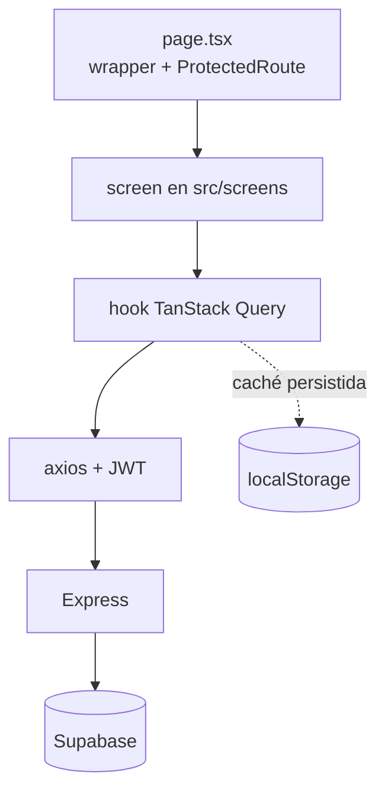

# Bóveda de la app Futcademic · 01-Proyecto

Notas técnicas internas de la app (Obsidian). Los [[enlaces]] apuntan a otras notas de la bóveda.

---

## Nota: Arquitectura

# Arquitectura

## Cuatro piezas



- **`landing/`** es estático: no lee Supabase ni la API. Solo enlaza al registro.
- **`web/`** es una SPA en la práctica: todo es cliente, sin SSR de datos.
- **`backend/`** es la única pieza con la `service role`; nunca se expone al navegador.
- **Supabase** hace dos trabajos: autenticación y Postgres.

## Ciclo de una petición

```text
Navegador
  → hook TanStack Query (web/src/hooks)
  → axios con interceptor JWT (web/src/api/axios.ts)
  → Express
      app.ts: CORS + JSON 1 MB + /api/health
      routes/index.ts: monta 17 routers
      requireAuth      → valida el Bearer con Supabase
      requireTenant    → lee users y fija { school_id, role, user_id }
      requireRole(...) → comprueba rol
      controller       → supabaseAdmin (service role)
  ← JSON (errores en español)
```

El detalle de los middlewares está en [[Middlewares y autenticacion]]; el aislamiento, en [[Multi-tenant]].

## Flujo de datos del panel



- `app/**/page.tsx` solo declara roles y monta la pantalla. Ver [[Rutas web]].
- La caché de consultas se persiste y se invalida con `NEXT_PUBLIC_BUILD_ID`.
- Auth de usuario vive en `AuthContext` (Supabase directo). El resto de datos pasa por hooks → axios.

## Autenticación vs. autorización

| Capa | Quién | Qué valida |
|---|---|---|
| Supabase Auth | navegador | email/usuario y contraseña; emite JWT |
| `requireAuth` | backend | que el JWT sea válido |
| `requireTenant` | backend | que exista fila en `users`; de ahí salen `school_id` y `role` |
| `requireRole` | backend | rol declarado por ruta |
| `findStudentForTenant` | backend | que el alumno pertenezca al tenant/usuario correcto |
| `ProtectedRoute` | web | rol para mostrar la pantalla (cosmético, no seguridad) |

## Chat IA

Ruta aparte, solo admin: SSE + loop Anthropic que ejecuta *tools* contra la propia API reutilizando el token del admin. Ver [[Chat IA]].

## Decisiones que sorprenden

1. **No hay SSR de datos**: el panel es cliente puro; `queryClient` usa storage no-op en servidor para hidratar igual.
2. **La PWA no depende de ningún plugin**: `public/sw.js` está escrito a mano y solo se registra en producción; la sesión sin conexión se lee de localStorage porque `getSession()` falla sin red. Ver [[Convenciones web]].
3. **`dist/` se commitea** en el repo del backend.
4. **`backend/` y `mobile/` son repos separados**; el raíz no los ve.
5. **`schema.sql` no declara RLS**; el aislamiento verificable está en el backend. Ver [[Deriva conocida]].
6. **`schema.sql` se describe a sí mismo como "no ejecutable"**; aun así es la base documental. Ver [[Deriva conocida]].

---

## Nota: Comandos y verificacion

# Comandos y verificacion

## Panel web (`web/`)

```bash
cd web
npm install
npm run dev        # http://localhost:5173
npm run build      # next build; incluye typecheck
npm run start      # sirve el build en 5173
npm run test:e2e   # Playwright con backend mockeado; levanta dev solo
```

| Tarea | Comando |
|---|---|
| Un solo test | `npx playwright test e2e/fase2.spec.ts -g "nombre"` |
| Smoke contra producción | `ALLOW_PROD_SMOKE=yes npm run test:smoke` ⚠️ crea academias reales |
| Video de e2e | `npm run e2e:video` |

## API (`backend/`)

```bash
cd backend
npm install
npm run dev          # ts-node api/index.ts, puerto 3000
npm test             # jest, todo api/__tests__
npm run build        # tsc → dist/
npm run routes:dump  # regenera api-contract.json
```

| Tarea | Comando |
|---|---|
| Un solo archivo | `npx jest api/__tests__/auth.test.ts` |
| Un solo test | `npx jest api/__tests__/auth.test.ts -t "nombre"` |

- Los tests mockean `supabaseAdmin`: no necesitan Supabase real.
- Tras cambiar rutas o roles: **`npm run routes:dump` es obligatorio**. `contract.test.ts` compara el JSON commiteado contra el router real.
- Tras cambiar `api/**`: **`npm run build` y commitear `dist/`** junto con la fuente.

## Landing (`landing/`)

```bash
cd landing
npm install
npm run dev        # http://localhost:4321
npm run build
npm run preview
npm run capturas   # regenera public/capturas/*.png y og.png
npm run demo       # regraba public/demo/recorrido.mp4 (ffmpeg)
```

## Bóveda (`vault/`)

```bash
python3 scripts/vault/vault.py generar
python3 scripts/vault/vault.py verificar
python3 scripts/vault/vault.py brief      # mapa de inicio; lo usan los hooks
```

Claude Code corre `brief` al abrir sesión y `generar` + `verificar` al cerrarla
(hooks en `~/.claude/hooks/futcademic-vault-*.sh`); el log queda en
`~/.claude/futcademic-vault-end.log`. Los comandos siguen sirviendo a mano.

## Qué verificar según el cambio

| Cambio | Verificación mínima |
|---|---|
| Ruta, controlador o rol | `npm test` · `npm run routes:dump` · `npm run build` · regenerar bóveda |
| Solo lógica interna del backend | `npm test` · `npm run build` |
| Pantalla, hook o componente web | `npm run build`; si es flujo de usuario, `npm run test:e2e` |
| Esquema o migración | Aplicar SQL · probar endpoint afectado · regenerar bóveda · actualizar docs EN/ES |
| Landing | `npm run build` |
| Texto de esta bóveda | `python3 scripts/vault/vault.py verificar` |
| Cualquier cambio de código | entrada en [[Bitacora de sesiones]] |

## Puertos

| Servicio | Puerto |
|---|---|
| Panel Next | 5173 |
| API Express | 3000 (o `PORT`) |
| Landing Astro | 4321 |

No hay task runner raíz, workspaces ni CI: cada verificación se corre a mano.

---

## Nota: Despliegue

# Despliegue

| Pieza | Destino | Notas |
|---|---|---|
| `web/` | Vercel | Next.js detectado automáticamente; **no hay `vercel.json`** |
| `backend/` | Render | `https://futcademic-backend.onrender.com`; arranca `node dist/index.js` |
| `landing/` | Host estático propio | Se sirve el `dist/` de Astro |
| Base de datos | Supabase | SQL aplicado a mano en el SQL Editor |

## Orden de un cambio con base de datos

1. Crear migración fechada en `migrations/` (`YYYYMMDD_descripcion.sql`), idempotente.
2. Aplicarla en Supabase **antes** de desplegar el código que depende de ella.
3. Actualizar `schema.sql` si el cambio debe existir en instalaciones nuevas.
4. `cd backend && npm run build` y commitear `dist/` con la fuente.
5. Actualizar docs EN/ES y regenerar la bóveda.

No hay runner de migraciones: se pegan en el SQL Editor, en orden de nombre. Ver [[Migraciones]].

## Backend en Render

- Build: `npm install && npm run build` (equivalente; `dist/` ya viene commiteado).
- Start: `node dist/index.js`.
- Variables: `SUPABASE_URL`, `SUPABASE_SERVICE_KEY` y, según uso, `ANTHROPIC_API_KEY`, `SENDGRID_API_KEY`, `SENDGRID_FROM_EMAIL`, `SENDGRID_FROM_NAME`, `WEB_APP_URL`, `CORS_ORIGIN`, `INTERNAL_API_URL`, `SCHOOL_TIMEZONE`, `PORT`.
- Health check: `GET /api/health` → `{ "status": "ok" }`.

## Web en Vercel

- Vercel detecta Next.js; si pide directorio del proyecto, es `web/`.
- Build: `npm run build`; output Next estándar.
- Variables: las tres `NEXT_PUBLIC_*`. `NEXT_PUBLIC_BUILD_ID` la genera el build.
- El `NEXT_PUBLIC_API_URL` debe apuntar al backend de Render con `/api`.

## Landing

- Build: `cd landing && npm run build`; publicar `dist/`.
- Variables `PUBLIC_*` en el host.
- Si `PUBLIC_APP_URL` falta, los CTA apuntan al dominio de ejemplo.

## Checklist post-deploy

- [ ] `GET /api/health` responde 200.
- [ ] Login y una lectura autenticada funcionan (JWT + tenant).
- [ ] La web apunta al backend correcto (consola sin CORS).
- [ ] Las migraciones nuevas están aplicadas.
- [ ] `npm run routes:dump` sin cambios pendientes en `api-contract.json`.

No hay CI ni hooks: este checklist es manual.

---

## Nota: Entornos y variables

# Entornos y variables

## API (`backend/`)

| Variable | Uso | Obligatoria |
|---|---|---|
| `SUPABASE_URL` | URL del proyecto Supabase | sí |
| `SUPABASE_SERVICE_KEY` | Service role. **No** se llama `SUPABASE_SERVICE_ROLE_KEY` | sí |
| `PORT` | Puerto de Express (default 3000) | no |
| `CORS_ORIGIN` | Origen permitido (default `*`) | no |
| `ANTHROPIC_API_KEY` | Chat IA | para el chat |
| `SENDGRID_API_KEY` | Envío de invitaciones | para email |
| `SENDGRID_FROM_EMAIL` | Remitente (default `no-reply@futcademic.com`) | no |
| `SENDGRID_FROM_NAME` | Nombre del remitente (default `Futcademic`) | no |
| `WEB_APP_URL` | Base de los links de activación (default `http://localhost:5173`) | no |
| `INTERNAL_API_URL` | Base para las tools del chat | no |

- `api/config/supabase.ts` **lanza al importar** si falta `SUPABASE_URL` o `SUPABASE_SERVICE_KEY`. Tests y scripts deben definir ambas.
- `api/index.ts` carga `dotenv` solo si `NODE_ENV !== 'production'`; en Render las variables se inyectan.
- Sin `SENDGRID_API_KEY`, `isEmailConfigured()` es `false` y **la invitación no se envía** (se registra un aviso, no falla).

## Panel (`web/`)

| Variable | Uso |
|---|---|
| `NEXT_PUBLIC_API_URL` | Base de la API. Fallback: `http://localhost:3000/api` |
| `NEXT_PUBLIC_SUPABASE_URL` | Proyecto Supabase |
| `NEXT_PUBLIC_SUPABASE_ANON_KEY` | Clave anónima (pública) |
| `NEXT_PUBLIC_BUILD_ID` | Inyectada por `next.config.ts` en cada build; invalida la caché persistida |

## Landing (`landing/`)

| Variable | Uso | Default |
|---|---|---|
| `PUBLIC_APP_URL` | Base de los CTA a `/register` | `https://app.futcademic.com` |
| `PUBLIC_SITE_URL` | URL canónica (OG, sitemap) | `https://futcademic.com` |
| `PUBLIC_PRIVACY_URL` | Aviso de privacidad; vacío ⇒ no se enlaza | vacío |

## Reglas de secretos

- `backend/.env` está **commiteado** en su repo por legado. No agregar secretos nuevos en texto plano.
- El `.gitignore` raíz bloquea `**/.env`, `.env.local`, `.env.production`, `.env.test` y variantes.
- La `service key` solo vive en el backend. El navegador usa la `anon key`.
- Nunca poner secretos en `NEXT_PUBLIC_*`: se bundlean al cliente.

Ver [[Despliegue]] para dónde va cada variable.

---

## Nota: Mapa del repositorio

# Mapa del repositorio

## Qué vive dónde

| Ruta | Qué es | Repo git |
|---|---|---|
| `web/` | Panel administrativo. Next.js 16 App Router + React 19 + Mantine + TanStack Query | raíz |
| `landing/` | Sitio público estático. Astro, sin JS de cliente propio | raíz |
| `backend/` | API REST. Express + TypeScript + Supabase | **independiente** (`futcademic-backend`) |
| `mobile/` | App Expo. **Fuera de alcance por ahora** | **independiente** (`futcademic-mobile`) |
| `docs/` | Producto, técnica, scrum, PDFs (pares EN/ES) | raíz |
| `migrations/` | SQL incremental fechado | raíz |
| `schema.sql` | Esquema base de referencia | raíz |
| `mineria/` | Dataset sintético del proyecto de minería | raíz |
| `compartir/` | Resúmenes del proyecto para exposición | raíz |
| `scripts/` | Importaciones one-off + `vault/vault.py` | raíz |
| `vault/` | Esta bóveda Obsidian | raíz |

`mobile/` y `backend/` están en `.gitignore` del repo raíz. `git status` desde la raíz **no muestra** sus cambios: se commitean desde dentro de cada carpeta.

## Árbol resumido

```text
Futcademic/
├── AGENTS.md                  instrucciones para agentes (fuente de verdad operativa)
├── schema.sql                 18 tablas base
├── migrations/                4 migraciones fechadas
├── docs/
│   ├── product/               PRD y definición (EN/ES)
│   ├── technical/             API y esquema (EN/ES)
│   ├── arquitectura/          entregables académicos
│   └── scrum/                 historias de usuario
├── web/
│   ├── app/                   rutas Next (page.tsx finos)
│   └── src/                   screens, hooks, api, contexts, components
├── landing/
│   └── src/consts.ts          todo el copy del sitio
├── backend/
│   ├── api/                   routes, controllers, services, middlewares
│   └── dist/                  build commiteado
├── mineria/                   generador + dataset + validación
├── compartir/                 resúmenes de exposición
├── scripts/vault/vault.py     genera y verifica esta bóveda
└── vault/                     notas
```

## No buscar aquí

| Ruta | Por qué |
|---|---|
| `**/node_modules/` | Dependencias; usa `package.json` |
| `backend/dist/` | Build; la fuente está en `backend/api/` |
| `web/.next/`, `web/playwright-report/`, `web/test-results/` | Artefactos |
| `.claude/worktrees/` | Copias de trabajo antiguas; no es el código vigente |
| `*.pen` | Diseños binarios, ignorados por git |
| `**/package-lock.json`, `pnpm-lock.yaml` | Ruido; hay dos lockfiles en `web/` (npm manda) |

## Regla de alcance

El foco actual es **`backend/` + `web/` + `landing/`**. `mobile/` no se toca ni se replica salvo petición explícita.

## Dónde seguir

- Piezas y flujo de una petición: [[Arquitectura]]
- Comandos por workspace: [[Comandos y verificacion]]
- Qué está desactualizado: [[Deriva conocida]]
