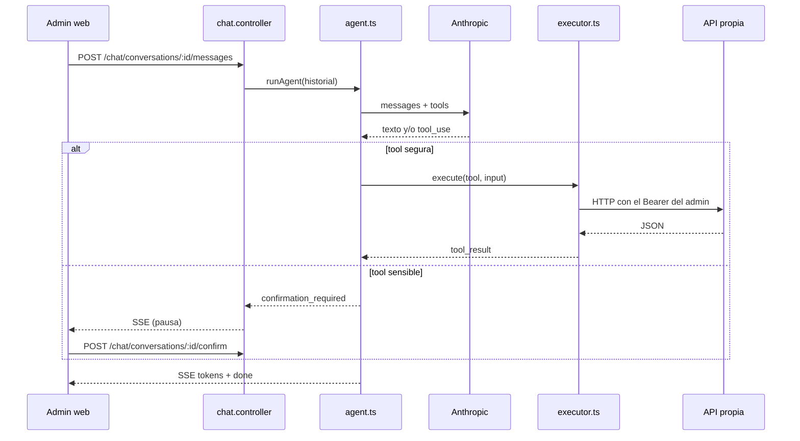

# Bóveda de la app Futcademic · 02-Backend

Notas técnicas internas de la app (Obsidian). Los [[enlaces]] apuntan a otras notas de la bóveda.

---

## Nota: API - rutas

<!-- No editar a mano: python3 scripts/vault/vault.py generar -->

# API - rutas

Contrato real del backend, leído de `backend/api-contract.json`.

- **107 endpoints** en **19 grupos**.
- **8 públicos** (sin token); el resto exige `Authorization: Bearer`.
- La columna **Acceso** sale de `requireRole(...)`; `autenticado` significa que la ruta no declara roles.

> [!info] Cómo regenerar
> `cd backend && npm run routes:dump` y después `python3 scripts/vault/vault.py generar`.

## Grupos

- [[#auth]] (5)
- [[#users]] (8)
- [[#students]] (20)
- [[#attendances]] (4)
- [[#categories]] (9)
- [[#payments]] (7)
- [[#events]] (8)
- [[#schools]] (1)
- [[#venues]] (4)
- [[#permissions]] (3)
- [[#dashboard]] (4)
- [[#export]] (2)
- [[#notifications]] (3)
- [[#achievements]] (2)
- [[#upload]] (2)
- [[#parents]] (3)
- [[#chat]] (6)
- [[#health]] (1)
- [[#enrollment]] (15)

## auth

5 endpoints · `backend/api/routes/auth.routes.ts`

| Método | Ruta | Acceso |
| --- | --- | --- |
| `POST` | `/api/auth/invite-admin` | super_admin, admin |
| `POST` | `/api/auth/invite-parent` | super_admin, admin, profesor |
| `POST` | `/api/auth/invite-teacher` | super_admin, admin |
| `POST` | `/api/auth/register` | público |
| `POST` | `/api/auth/resolve-student` | público |

## users

8 endpoints · `backend/api/routes/user.routes.ts`

| Método | Ruta | Acceso |
| --- | --- | --- |
| `GET` | `/api/users` | super_admin, admin, profesor |
| `PUT` | `/api/users/:id` | super_admin, admin |
| `POST` | `/api/users/me/complete-onboarding` | autenticado |
| `PATCH` | `/api/users/me/password` | autenticado |
| `PATCH` | `/api/users/me/password-changed` | autenticado |
| `PATCH` | `/api/users/me/profile` | autenticado |
| `PATCH` | `/api/users/me/push-token` | autenticado |
| `GET` | `/api/users/teachers/:id` | super_admin, admin |

## students

20 endpoints · `backend/api/routes/student.routes.ts`

| Método | Ruta | Acceso |
| --- | --- | --- |
| `GET` | `/api/students` | super_admin, admin, profesor, padre |
| `POST` | `/api/students` | super_admin, admin, profesor |
| `DELETE` | `/api/students/:id` | super_admin, admin |
| `GET` | `/api/students/:id` | super_admin, admin, profesor, padre |
| `PUT` | `/api/students/:id` | super_admin, admin, profesor |
| `POST` | `/api/students/:id/consent` | super_admin, admin, profesor |
| `GET` | `/api/students/:id/consent.pdf` | super_admin, admin, padre, alumno |
| `POST` | `/api/students/:id/documents` | super_admin, admin, profesor |
| `DELETE` | `/api/students/:id/documents/:docId` | super_admin, admin, profesor |
| `PATCH` | `/api/students/:id/documents/:docId` | super_admin, admin, profesor |
| `GET` | `/api/students/:id/documents/:docId/url` | super_admin, admin, padre, alumno |
| `POST` | `/api/students/:id/documents/reuse-tutor` | super_admin, admin, profesor |
| `GET` | `/api/students/:id/expediente` | super_admin, admin, profesor, padre, alumno |
| `GET` | `/api/students/:id/expediente/package` | super_admin, admin |
| `GET` | `/api/students/:id/stats` | super_admin, admin, profesor, padre, alumno |
| `PATCH` | `/api/students/:id/status` | super_admin, admin |
| `GET` | `/api/students/:id/team` | super_admin, admin, profesor, padre, alumno |
| `GET` | `/api/students/:id/tutor-documents/availability` | super_admin, admin, profesor |
| `PATCH` | `/api/students/:id/uniform` | super_admin, admin, profesor |
| `GET` | `/api/students/deleted` | super_admin, admin |

## attendances

4 endpoints · `backend/api/routes/attendance.routes.ts`

| Método | Ruta | Acceso |
| --- | --- | --- |
| `POST` | `/api/attendances` | super_admin, admin, profesor |
| `GET` | `/api/attendances/category/:id` | super_admin, admin, profesor |
| `GET` | `/api/attendances/student/:id` | super_admin, admin, profesor, padre, alumno |
| `PATCH` | `/api/attendances/trainings/:id/complete` | super_admin, admin, profesor |

## categories

9 endpoints · `backend/api/routes/category.routes.ts`

| Método | Ruta | Acceso |
| --- | --- | --- |
| `GET` | `/api/categories` | autenticado |
| `POST` | `/api/categories` | super_admin, admin, profesor |
| `GET` | `/api/categories/:id` | autenticado |
| `PATCH` | `/api/categories/:id` | super_admin, admin, profesor |
| `PATCH` | `/api/categories/:id/status` | super_admin, admin |
| `POST` | `/api/categories/:id/teachers` | super_admin, admin, profesor |
| `DELETE` | `/api/categories/:id/teachers/:teacherId` | super_admin, admin, profesor |
| `POST` | `/api/categories/full` | super_admin, admin, profesor |
| `GET` | `/api/categories/mine` | profesor |

## payments

7 endpoints · `backend/api/routes/payment.routes.ts`

| Método | Ruta | Acceso |
| --- | --- | --- |
| `GET` | `/api/payments` | super_admin, admin |
| `GET` | `/api/payments/account-statement/:studentId` | super_admin, admin, padre |
| `GET` | `/api/payments/pending` | super_admin, admin |
| `GET` | `/api/payments/student/:id` | super_admin, admin, padre, alumno |
| `POST` | `/api/payments/students` | super_admin, admin |
| `GET` | `/api/payments/summary` | super_admin, admin |
| `POST` | `/api/payments/teachers` | super_admin, admin |

## events

8 endpoints · `backend/api/routes/event.routes.ts`

| Método | Ruta | Acceso |
| --- | --- | --- |
| `GET` | `/api/events` | autenticado |
| `POST` | `/api/events` | super_admin, admin, profesor |
| `DELETE` | `/api/events/:id` | super_admin, admin |
| `GET` | `/api/events/:id` | autenticado |
| `PUT` | `/api/events/:id` | super_admin, admin, profesor |
| `GET` | `/api/events/:id/trainings` | autenticado |
| `POST` | `/api/events/cancel` | super_admin, admin, profesor |
| `GET` | `/api/events/trainings` | autenticado |

## schools

1 endpoints · `backend/api/routes/school.routes.ts`

| Método | Ruta | Acceso |
| --- | --- | --- |
| `PUT` | `/api/schools/:id` | super_admin, admin |

## venues

4 endpoints · `backend/api/routes/venue.routes.ts`

| Método | Ruta | Acceso |
| --- | --- | --- |
| `GET` | `/api/venues` | autenticado |
| `POST` | `/api/venues` | super_admin, admin |
| `DELETE` | `/api/venues/:id` | super_admin, admin |
| `PATCH` | `/api/venues/:id` | super_admin, admin |

## permissions

3 endpoints · `backend/api/routes/permission.routes.ts`

| Método | Ruta | Acceso |
| --- | --- | --- |
| `GET` | `/api/permissions/:id` | super_admin, admin |
| `PUT` | `/api/permissions/:id` | super_admin, admin |
| `GET` | `/api/permissions/mine` | profesor |

## dashboard

4 endpoints · `backend/api/routes/dashboard.routes.ts`

| Método | Ruta | Acceso |
| --- | --- | --- |
| `GET` | `/api/dashboard/admin` | super_admin, admin |
| `GET` | `/api/dashboard/alumno` | super_admin, admin, alumno |
| `GET` | `/api/dashboard/padre` | super_admin, admin, padre |
| `GET` | `/api/dashboard/profesor` | super_admin, admin, profesor |

## export

2 endpoints · `backend/api/routes/export.routes.ts`

| Método | Ruta | Acceso |
| --- | --- | --- |
| `GET` | `/api/export/attendance` | super_admin, admin |
| `GET` | `/api/export/payments` | super_admin, admin |

## notifications

3 endpoints · `backend/api/routes/notification.routes.ts`

| Método | Ruta | Acceso |
| --- | --- | --- |
| `GET` | `/api/notifications` | autenticado |
| `PATCH` | `/api/notifications/:id/read` | autenticado |
| `PATCH` | `/api/notifications/read-all` | autenticado |

## achievements

2 endpoints · `backend/api/routes/achievement.routes.ts`

| Método | Ruta | Acceso |
| --- | --- | --- |
| `GET` | `/api/achievements` | super_admin, admin, alumno, padre |
| `POST` | `/api/achievements/check` | super_admin, admin, profesor |

## upload

2 endpoints · `backend/api/routes/upload.routes.ts`

| Método | Ruta | Acceso |
| --- | --- | --- |
| `POST` | `/api/upload/avatar` | super_admin, admin, profesor, padre, alumno |
| `POST` | `/api/upload/logo` | super_admin, admin |

## parents

3 endpoints · `backend/api/routes/parent.routes.ts`

| Método | Ruta | Acceso |
| --- | --- | --- |
| `DELETE` | `/api/parents/children/:id` | padre |
| `POST` | `/api/parents/link-child` | padre |
| `GET` | `/api/parents/me/children` | padre |

## chat

6 endpoints · `backend/api/routes/chat.routes.ts`

| Método | Ruta | Acceso |
| --- | --- | --- |
| `GET` | `/api/chat/conversations` | super_admin, admin |
| `DELETE` | `/api/chat/conversations/:id` | super_admin, admin |
| `POST` | `/api/chat/conversations/:id/confirm` | super_admin, admin |
| `GET` | `/api/chat/conversations/:id/messages` | super_admin, admin |
| `POST` | `/api/chat/conversations/:id/messages` | super_admin, admin |
| `POST` | `/api/chat/messages/:id/feedback` | super_admin, admin |

## health

1 endpoints · `backend/api/app.ts`

| Método | Ruta | Acceso |
| --- | --- | --- |
| `GET` | `/api/health` | público |

## enrollment

15 endpoints · —

| Método | Ruta | Acceso |
| --- | --- | --- |
| `GET` | `/api/enrollment/:token` | público |
| `GET` | `/api/enrollment/:token/consent.pdf` | público |
| `POST` | `/api/enrollment/:token/documents` | público |
| `PUT` | `/api/enrollment/:token/draft` | público |
| `POST` | `/api/enrollment/:token/submit` | público |
| `GET` | `/api/enrollment/applications` | super_admin, admin, profesor |
| `GET` | `/api/enrollment/applications/:id` | super_admin, admin, profesor |
| `POST` | `/api/enrollment/applications/:id/approve` | super_admin, admin |
| `PATCH` | `/api/enrollment/applications/:id/documents/:docId` | super_admin, admin |
| `POST` | `/api/enrollment/applications/:id/reject` | super_admin, admin |
| `POST` | `/api/enrollment/applications/:id/reopen` | super_admin, admin |
| `GET` | `/api/enrollment/consent-template` | super_admin, admin, profesor |
| `GET` | `/api/enrollment/invitations` | super_admin, admin, profesor |
| `POST` | `/api/enrollment/invitations` | super_admin, admin, profesor |
| `DELETE` | `/api/enrollment/invitations/:id` | super_admin, admin |

---

## Nota: Alumnos y acceso

# Alumnos y acceso

## Invariantes

1. **`students.id` = `users.id`** para un alumno: se crean juntos en Auth y en `users`.
2. **`students.parent_id`** apunta a `users.id` del padre/tutor.
3. `students.school_id` siempre sale de `req.tenant.school_id`.
4. El alumno no tiene email real: usa `username@<school_id>.alumno.futcademic.local`.
5. `status`: `activo`, `beca`, `pendiente`, `inactivo`.

## Alta

`POST /api/students` (`super_admin`, `admin`, `profesor`)

1. Genera username `nombre.apellido###` único por escuela.
2. Crea usuario en Auth con contraseña temporal y `email_confirm: true`.
3. Inserta `users` con `role: 'alumno'`, `username`, `must_change_password: true`.
4. Inserta `profile_information` vacío.
5. Inserta `students` con el mismo `id` y `status: 'activo'`.
6. Devuelve el alumno + `username` + `temp_password` para que el admin los entregue.

## Listado

`GET /api/students`

| Filtro | Efecto |
|---|---|
| `?category_id=` | filtra por categoría |
| `?parent_id=me` | resuelve al `user_id` del token |
| rol `padre` | fuerza `parent_id = user_id` |
| rol `profesor` | limita a alumnos de sus categorías (`category_teachers`) |

Un profesor sin categorías recibe `[]`, no un error.

## Detalle y edición

| Endpoint | Rol | Nota |
|---|---|---|
| `GET /students/:id` | admin, profesor, padre | pasa por `findStudentForTenant`; añade email de Auth |
| `PUT /students/:id` | admin, profesor | filtra `school_id`; actualiza `students`, `users` y `profile_information` |
| `PATCH /students/:id/uniform` | admin, profesor | `uniform_delivered` |
| `PATCH /students/:id/status` | admin | cambia `status` |
| `DELETE /students/:id` | admin | archiva y **borra permanente** |

## Eliminación

`DELETE /students/:id` no es soft delete:

1. Copia el alumno a `deleted_students` (con `deleted_by`).
2. Borra la fila de `students`.
3. Asume cascada en asistencias/logros y `student_id = NULL` en pagos; el SQL versionado no declara `ON DELETE` (ver [[Deriva conocida]]).

No hay endpoint de restauración. El histórico está en `GET /api/students/deleted` (admin).

## Stats y equipo

| Endpoint | Rol | Contenido |
|---|---|---|
| `GET /students/:id/stats` | admin, profesor, padre, alumno | asistencias, rachas, pagos, logros |
| `GET /students/:id/team` | admin, alumno | compañeros de categoría |

Ambos llaman a `findStudentForTenant` cuando aplica.

## Regla al agregar endpoints

Si la ruta recibe un `studentId`, **usa `findStudentForTenant`**. `requireRole` por sí solo deja que un padre cambie el id de la URL. Ver [[Middlewares y autenticacion]].

Tablas: [[Tablas#students]], [[Tablas#deleted_students]], [[Tablas#users]].

---

## Nota: Asistencias

# Asistencias

## Dos tablas

| Tabla | Qué guarda |
|---|---|
| `trainings` | Una sesión concreta (ocurrencia de un evento) con fecha, hora, sede y categoría |
| `attendances` | Una marca por alumno y sesión: `present` booleano |

`attendances` tiene `student_id`, `category_id`, `teacher_id`, `training_id`, `date`, `type` (`entrenamiento` \| `partido`).

## Pase de lista

`POST /api/attendances` — `super_admin`, `admin`, `profesor`

```json
{
  "category_id": "uuid",
  "date": "2026-10-26",
  "type": "entrenamiento",
  "training_id": "uuid-o-event-id-o-temp",
  "records": [{ "student_id": "uuid", "present": true }]
}
```

Comportamiento real:

1. Valida que los alumnos existan **en la escuela**.
2. Resuelve `training_id`: si no existe en `trainings`, lo busca como `event_id` para esa fecha; si no, lo deja `NULL`.
3. **Borra** las marcas previas de esos alumnos para esa fecha y tipo.
4. Inserta el lote nuevo.

Es un *replace* manual, no un upsert por constraints. Reenviar el pase de lista del mismo día sobrescribe.

## Consultas

| Endpoint | Rol | Uso |
|---|---|---|
| `GET /attendances/category/:id?date=` | admin, profesor | lista del día por categoría |
| `GET /attendances/student/:id` | admin, profesor, padre, alumno | historial; pasa por `findStudentForTenant` |
| `PATCH /attendances/trainings/:id/complete` | admin, profesor | marca `trainings.is_completed` |

## Rachas y logros

`attendances` **no** actualiza `current_streak`, `max_streak` ni `last_attendance_date`. El backend solo los **lee** (dashboard, stats, logros). No hay trigger en `schema.sql` ni migraciones.

`POST /achievements/check` compara `current_streak`/`max_streak` contra `achievements.threshold` y desbloquea, pero si nadie escribe la racha, los logros de racha no avanzan. El documento de minería afirma que la racha se actualiza en cada marca: **no verificable en este repo** (podría estar en la app móvil o en Supabase). Ver [[Deriva conocida]].

## Quién lo llama

La pantalla web manda **todos** los alumnos de la categoría (menos los
inactivos sin marca) con `present` true o false, y el `training_id` de la
sesión del día cuando la hay. Ver [[Modulo Asistencias|Módulo Asistencias]].

## Dónde mirar

- Lógica: `backend/api/controllers/attendance.controller.ts`
- Prueba de integración: `TC-I-03 — Pase de lista batch`
- Tablas: [[Tablas#trainings]], [[Tablas#attendances]]

---

## Nota: Auth y usuarios

# Auth y usuarios

## Registro de una academia

`POST /api/auth/register` (público, 10/hora por IP)

1. Crea el usuario en Supabase Auth con `email_confirm: true`.
2. Crea la fila en `schools`.
3. Crea la fila en `users` con `role: 'admin'` y `school_id`.
4. Crea `profile_information` vacío.
5. Devuelve 201; el cliente inicia sesión y pasa por onboarding.

Si falla el alta de `schools`, borra el usuario de Auth. Si falla `profile_information`, solo lo registra en log: no tumba el registro.

## Invitaciones

| Endpoint | Rol que invita | Destino |
|---|---|---|
| `POST /api/auth/invite-admin` | `super_admin`, `admin` | otro admin |
| `POST /api/auth/invite-teacher` | `super_admin`, `admin` | profesor |
| `POST /api/auth/invite-parent` | `super_admin`, `admin`, `profesor` | padre/tutor |

Flujo (`inviteUser` en `auth.controller.ts`):

1. `supabaseAdmin.auth.admin.generateLink({ type: 'invite' })` — Supabase genera el token, **no** envía el correo.
2. Se arma el link `WEB_APP_URL/accept-invite?token_hash=...&type=invite`.
3. Se envía por SendGrid si `SENDGRID_API_KEY` existe.
4. Se inserta la fila en `users` con el rol pedido.
5. Si el email ya existe, distingue "ya está en tu escuela" de "pertenece a otra escuela".

La pantalla `accept-invite` verifica el token con `supabase.auth.verifyOtp({ token_hash, type })`. Sin SendGrid, la invitación queda creada pero **nadie recibe el link**.

## Alta de alumno

No usa invitación: crea identidad con **contraseña temporal** y `must_change_password: true`. Ver [[Alumnos y acceso]].

## Login de alumno sin email

1. `POST /api/auth/resolve-student` recibe `username` (público, 20/10 min).
2. Devuelve el email interno `username@<school_id>.alumno.futcademic.local`.
3. El cliente entra a Supabase Auth con email + contraseña.

El username se genera como `nombre.apellido###`, único por escuela (`users_school_username_unique`).

## Endpoints de usuario

| Endpoint | Rol | Uso |
|---|---|---|
| `GET /api/users` | admin, profesor | listado; `?role=profesor` filtra |
| `GET /api/users/teachers/:id` | admin | ficha del profesor |
| `PUT /api/users/:id` | admin | editar datos del usuario |
| `PATCH /api/users/me/profile` | autenticado | perfil propio |
| `PATCH /api/users/me/password` | autenticado | cambiar contraseña |
| `PATCH /api/users/me/password-changed` | autenticado | marcar `must_change_password=false` |
| `PATCH /api/users/me/push-token` | autenticado | registrar token push |
| `POST /api/users/me/complete-onboarding` | autenticado | setear `onboarded_at` |

## Permisos de profesor

`teacher_permissions` guarda seis flags: `can_manage_students`, `can_manage_events`, `can_view_finances`, `can_manage_payments`, `can_take_attendance`, `can_manage_categories`.

| Endpoint | Rol |
|---|---|
| `GET /api/permissions/mine` | profesor |
| `GET /api/permissions/:id` | admin |
| `PUT /api/permissions/:id` | admin |

> [!warning] Los flags no se aplican en las rutas
> Las rutas solo usan `requireRole`. No hay middleware que consulte `teacher_permissions` (verificado 2026-10-26). Los flags se guardan, se editan y se muestran, pero **hoy no restringen la API**. No los presentes como control de acceso efectivo.

Ver [[Roles y permisos]] y [[Flujos clave]].

---

## Nota: Categorias y equipo

# Categorias y equipo

## Categoría

`categories` agrupa alumnos por año de nacimiento:

| Campo | Uso |
|---|---|
| `name` | Ej. `Sub-10` |
| `birth_year` | Etiqueta de la generación (`text`): un año, un rango o un grupo. Ver [[Modulo Categorias]] |
| `monthly_fee` | Cuota base para calcular pendientes |
| `color` | Color en la UI |

## Endpoints

| Endpoint | Rol | Nota |
|---|---|---|
| `GET /categories` | autenticado | todas las de la escuela |
| `GET /categories/mine` | profesor | solo las asignadas |
| `POST /categories` | admin | crear |
| `PATCH /categories/:id` | admin | editar |
| `POST /categories/:id/teachers` | admin | asignar profesor (`teacher_id`) |
| `POST /categories/full` | admin | categoría + profesores + evento recurrente |

`POST /categories/full` es el alta guiada: crea la categoría, inserta filas en `category_teachers` y, si recibe `days`, `start_time`, `venue_id`, `duration_minutes` y `recurrence_weeks`, crea el evento y sus sesiones. Devuelve advertencias si alguna parte opcional falla sin tumbar la categoría.

## Muchos profesores por categoría

`category_teachers` es la tabla puente (`school_id`, `category_id`, `teacher_id`). Un profesor puede tener varias categorías y una categoría varios profesores.

- `GET /students` limita al profesor a los alumnos de sus categorías.
- `GET /categories/mine` alimenta el selector del pase de lista.
- Asignar dos veces al mismo profesor falla con 400 ("¿Ya está asignado?").

## Permisos del profesor

`teacher_permissions` (1:1 con profesor) guarda:

`can_manage_students` · `can_manage_events` · `can_view_finances` · `can_manage_payments` · `can_take_attendance` · `can_manage_categories`

Se editan en `PUT /api/permissions/:id` (admin) y se leen en `GET /api/permissions/mine`.

> [!warning] No son control de acceso efectivo
> Las rutas usan `requireRole`, no estos flags. Un profesor con todos los flags en `false` sigue pudiendo llamar a los endpoints de su rol. Ver [[Roles y permisos]].

## Tablas

[[Tablas#categories]] · [[Tablas#category_teachers]] · [[Tablas#teacher_permissions]]

Pantallas: [[Pantallas]] (`/admin/categories`, `/admin/categories/[id]`, `/admin/teachers`).

---

## Nota: Chat IA - backend

# Chat IA - backend

## Qué es

Asistente para **admins** que responde en streaming (SSE) y puede **ejecutar acciones** sobre la API: listar alumnos, crear eventos, registrar pagos, borrar alumnos, invitar usuarios.

- Modelo: `claude-haiku-4-5`.
- Loop manual de Anthropic, máximo **15 iteraciones**.
- 34 *tools* declaradas; cada una apunta a un endpoint real del backend.
- Solo `super_admin` y `admin` (`router.use(... requireRole(...))`).
- El mensaje puede llevar `context` (pantalla abierta, registro en foco y
  filtros): el agente lo recibe en un bloque de sistema aparte y sin
  `cache_control` (ver [[Chat IA#Contexto de pantalla]]).

## Flujo



## Tools sensibles

Marcadas con `sensitive: true` en `tools.ts`: pagos, bajas de alumno, invitaciones y otras escrituras destructivas. El agente **no las ejecuta**: emite `confirmation_required`, guarda el estado en `chat_conversations.pending_state` y espera `POST /conversations/:id/confirm`.

Las tools llaman a la API con el **mismo token del admin**, así que no pueden hacer más de lo que ese admin ya puede hacer. `chat-tools.test.ts` verifica que las 34 apunten a endpoints existentes y respeten roles.

## Endpoints

| Endpoint | Uso |
|---|---|
| `GET /chat/conversations` | historial |
| `GET /chat/conversations/:id/messages` | mensajes |
| `POST /chat/conversations/:id/messages` | enviar; responde SSE |
| `POST /chat/conversations/:id/confirm` | aprobar/rechazar acciones |
| `DELETE /chat/conversations/:id` | borrar conversación |

## Archivos

| Archivo | Responsabilidad |
|---|---|
| `agent.ts` | loop, ensamblado del sistema y pausa por confirmación |
| `prompt.ts` | prompt de sistema (reutilizado por producción y evaluación) |
| `screen-context.ts` | saneado del contexto de pantalla y bloque de prompt |
| `eval-scoring.ts` | puntuación determinista del set de evaluación |
| `tools.ts` | definiciones JSON Schema + `SENSITIVE_TOOLS` |
| `executor.ts` | traduce tool → llamada HTTP interna |
| `store.ts` | conversaciones y mensajes en Supabase |
| `sse.ts` | eventos SSE |

## Evaluación

`scripts/eval-chat.ts` mide la capa del modelo **sin ejecutar herramientas**:
elige la herramienta correcta y evita las peligrosas. Reutiliza `prompt.ts` y
las 34 tools reales; los 38 casos viven en `scripts/eval/cases.json` y la
puntuación (`any_of`, `all_of`, `none_of`, `no_tools`, `arg`) en
`eval-scoring.ts`.

```bash
cd backend
npm run eval:chat                          # set completo
npm run eval:chat -- --category cobranza   # una categoría
npm run eval:chat -- --model otro-modelo   # comparar proveedores
```

Línea base: **38/38** con `claude-haiku-4-5`. El informe queda en
`scripts/eval/last-run.json` (ignorado por Git).

## Tablas

`chat_conversations` (`status`: `active` \| `awaiting_confirmation`, `pending_state` jsonb) y `chat_messages` (`content` jsonb con bloques exactos de Anthropic, `context` jsonb con la pantalla que acompañó al mensaje). Se crean en `migrations/20260709_add_chat_tables.sql`; el contexto se añade en `migrations/20261026_chat_message_context.sql`.

[[Tablas#chat_conversations]] · [[Tablas#chat_messages]]

## En la web

- `web/src/contexts/ChatContext.tsx`: estado compartido, queries de conversaciones y stream SSE (`runStream`).
- `web/src/hooks/useChat.ts` solo reexporta ese contexto.
- `web/src/lib/chatScreen.ts`: contexto genérico derivado de la ruta.
- `web/src/contexts/ChatScreenContext.ts`: registro del registro en foco desde
  las fichas de alumno, profesor, categoría y Finanzas.
- El widget flotante y `/admin/chat` comparten conversación activa y stream.

Pantalla: [[Pantallas]] (`/admin/chat`). Configuración: `ANTHROPIC_API_KEY` e `INTERNAL_API_URL`.

---

## Nota: Eventos y entrenamientos

# Eventos y entrenamientos

## Modelo

| Tabla | Rol |
|---|---|
| `events` | Serie o evento padre: categoría, sede, tipo, hora, regla de recurrencia |
| `trainings` | Ocurrencia concreta con fecha; es lo que se pasa a lista |
| `event_exceptions` | Excepciones por fecha (existe; la cancelación actual no la usa) |

`type`: `entrenamiento` o `partido`. `venues` aporta sede y coordenadas.

## Recurrencia

`POST /api/events` acepta dos mecanismos:

1. **Legacy semanal**: `recurringWeeks` (máximo 52). Genera N sesiones semanales.
2. **Regla explícita**: `recurrenceRule` con `pattern`, `daysOfWeek` y `endDate`.

Guarda `is_recurring`, `recurring_weeks`, `recurring_end_date` y `recurrence_rule`.

## Endpoints

| Endpoint | Rol | Uso |
|---|---|---|
| `GET /events` | autenticado | lista; `?category_id=` |
| `GET /events/:id` | autenticado | detalle |
| `GET /events/:id/trainings` | autenticado | sesiones de la serie |
| `GET /events/trainings?date=` | autenticado | sesiones de un día |
| `POST /events` | admin, profesor | crear serie + sesiones |
| `PUT /events/:id` | admin, profesor | editar |
| `POST /events/cancel` | admin, profesor | cancelar una sesión |
| `DELETE /events/:id` | admin | borrar |

## Cancelar una sesión

`POST /api/events/cancel` recibe `training_id` **o** `event_id + date`.

- Marca `trainings.is_cancelled = true`.
- Busca la categoría afectada y notifica por push a los padres con `push_token`.
- No borra la sesión ni el evento.

## Dónde mirar

- `backend/api/controllers/event.controller.ts` (generación de recurrencia y cancelación).
- `trainings` es la tabla que consulta el pase de lista: [[Asistencias]].
- Tablas: [[Tablas#events]], [[Tablas#trainings]], [[Tablas#event_exceptions]], [[Tablas#venues]].

---

## Nota: Mapa backend

# Mapa backend

## Capas

```text
api/index.ts        carga dotenv (solo fuera de producción) e inicia el listen
api/app.ts          CORS, JSON 1 MB, /api/health, 404/500 JSON
api/routes/index.ts monta 18 routers bajo /api
api/routes/*.ts     declara método + path + middlewares de rol
api/controllers/*   lógica y consultas a Supabase
api/services/       acceso a alumnos, credenciales, email, chat
api/middlewares/    auth, tenant, rate limit
api/config/         supabaseAdmin, push
```

## Carpetas

| Ruta | Qué contiene |
|---|---|
| `api/routes/` | 18 routers + `index.ts`; única fuente de métodos y roles |
| `api/controllers/` | 19 controladores; un archivo por recurso |
| `api/services/` | `access.ts`, `credentials.ts`, `email.service.ts`, `chat/` |
| `api/middlewares/` | `auth`, `tenant` (`requireRole`), `rate-limit`, `permission` |
| `api/config/` | `supabase.ts` (falla al importar sin env), `push.ts` |
| `api/__tests__/` | 28 suites Jest con Supabase mockeado |
| `api/scripts/` | `dump-routes.ts` → `api-contract.json` |
| `scripts/` | evaluación del chat (`eval-chat.ts`), exportación del dataset e importadores |
| `dist/` | Build commiteado; no editar a mano |

## Convenciones

- Un controlador por recurso, exports nombrados (`getStudents`, `createStudent`, …).
- Errores JSON en español; el `catch` responde 500 genérico.
- Toda consulta de tabla con tenant filtra `.eq('school_id', …)`.
- El tenant se lee de `req.tenant!`, **nunca** del body o query del cliente.
- Los endpoints con `:studentId` pasan por `findStudentForTenant`.
- Nombres de archivo no siempre coinciden con el recurso: `/attendances` vive en `attendance.routes.ts`; `/payments` en `payment.routes.ts`.

## Pruebas

- `npm test`: 28 suites, Supabase mockeado.
- `npm run eval:chat`: 38 casos de selección de herramienta del asistente, sin tocar la base de datos.
- `contract.test.ts` compara el router real con `api-contract.json`.
- `chat-tools.test.ts` valida que las 34 tools del chat apunten a endpoints existentes y respeten roles.

## Antes de tocar

- [[Middlewares y autenticacion]] para el orden de guards.
- [[Multi-tenant]] para el aislamiento.
- [[Agregar un endpoint]] para el procedimiento completo.

Rutas exactas: [[API - rutas]].

---

## Nota: Middlewares y autenticacion

# Middlewares y autenticacion

## Cadena típica

```text
requireAuth → requireTenant → requireRole(...) → controller
```

| Middleware | Qué hace | Falla con |
|---|---|---|
| `requireAuth` | Lee `Authorization: Bearer`, valida el JWT con `supabaseAdmin.auth.getUser` y deja `req.user` | 401 |
| `requireTenant` | Busca la fila en `users` y fija `req.tenant = { school_id, role, user_id }` | 401 si no hay auth; 403 si no tiene escuela |
| `requireRole(...roles)` | Compara `req.tenant.role` contra la lista | 403 |
| `rateLimit({max, windowMs})` | Ventana en memoria por IP; `Retry-After` en 429 | 429 |
| `findStudentForTenant` | Autorización por fila para endpoints con alumno | 404/403/500 |

## Orden real

1. `app.ts` aplica CORS y `express.json({ limit: '1mb' })`.
2. Cada router decide: algunos hacen `router.use(requireAuth, requireTenant)` y luego `requireRole` por ruta.
3. `requireRole` **solo mira el rol**. No valida pertenencia de filas.
4. Por eso todo `studentId` debe pasar por `findStudentForTenant`.

## `findStudentForTenant`

`backend/api/services/access.ts`

| Rol | Puede ver |
|---|---|
| `super_admin`, `admin`, `profesor` | cualquier alumno de su escuela |
| `padre` | alumnos con `students.parent_id === user_id` |
| `alumno` | su propia ficha (`students.id === user_id`) |

Siempre filtra `id` **y** `school_id`. Devuelve `{ student }` o `{ denied: { status, error } }`.

> [!warning] Regla de seguridad
> `requireRole` no impide que un padre cambie el id de la URL y lea otra familia. Si el endpoint recibe un alumno y no llama a `findStudentForTenant`, es un hueco de autorización.

## Rate limit

| Ruta | Límite |
|---|---|
| `POST /api/auth/register` | 10 por hora por IP |
| `POST /api/auth/resolve-student` | 20 cada 10 minutos por IP |

Es por proceso: no es cuota estricta con varias instancias, pero corta el escaneo automatizado. `resolve-student` traduce un username al email interno del alumno; sin límite permitiría enumerar el padrón.

## `requireRole` y el contrato

`requireRole` adjunta la lista de roles a la función guard (`(guard as any).roles = roles`). `dump-routes.ts` lee esa propiedad para generar `api-contract.json`. Si se declara el rol de otra forma, el contrato sale sin roles.

## Checklist al crear una ruta

- [ ] `requireAuth` + `requireTenant` (o `router.use`).
- [ ] `requireRole(...)` con los roles mínimos.
- [ ] Si recibe alumno: `findStudentForTenant`.
- [ ] Si es pública: `rateLimit`.
- [ ] `npm run routes:dump`.
- [ ] Test de RBAC/ownership si aplica.

Ver [[Roles y permisos]] y [[Agregar un endpoint]].

---

## Nota: Pagos

# Pagos

## Dos tipos

| `payment_type` | Quién paga | Campos |
|---|---|---|
| `mensualidad` | alumno/tutor | `student_id` o `payment_students` |
| `pago_profesor` | profesor | `teacher_id` |

`payment_month` y `payment_year` indican **a qué periodo corresponde** el pago, independientes de `payment_date` (fecha de la transacción).

## Individual vs. grupal

`POST /api/payments/students`

- **1 alumno** (`student_id`): un `payments` con `student_id`.
- **Varios** (`student_ids: []`): un `payments` padre con `student_id = NULL` y una fila por alumno en `payment_students` con el monto **dividido en partes iguales** (`amount / n`).

Al registrar, notifica por push al padre del alumno (si tiene `push_token`).

## Mensualidades pendientes

`GET /api/payments/pending?month=&year=` — admin

1. Toma alumnos con `status` `activo` o `pendiente`.
2. Esperado = `categories.monthly_fee` de su categoría.
3. Pagado = suma de pagos directos + `payment_students` de ese mes/año.
4. Devuelve solo a quienes `pagado < esperado`, con `pending_amount` y totales.

Una beca (`status = beca`) **no** aparece en pendientes.

## Estado de cuenta

`GET /api/payments/account-statement/:studentId` — admin, padre

- Verifica que el padre sea dueño del alumno (chequeo propio, no `findStudentForTenant`).
- Suma pagos directos + grupales.
- Devuelve `monthlyFee`, `pendingAmount`, `hasPaidThisMonth`, `totalPaid` y `movements`.

`dueDate` se calcula con el año en curso (`<año actual>-<mes>-10`), así que no hay que tocarlo cada enero.

## Resumen del año (salud financiera)

`GET /api/payments/summary?year=` — admin

Una sola consulta anual (`payments` de ese `payment_year` y tipos `mensualidad`/`pago_profesor`) que devuelve los 12 meses con `collected`, `payroll` y `margin`, más los `totals` del año. Es la fuente de los KPIs y la gráfica de `/finances`; el "por cobrar" y la tasa de cobranza se calculan en el cliente cruzando este resumen con `GET /payments/pending`.

- `collected` suma mensualidades; `payroll` suma `pago_profesor`.
- `margin = collected - payroll`.
- Meses sin movimientos vienen en ceros, nunca ausentes.

## Endpoints

| Endpoint | Rol |
|---|---|
| `GET /payments` | admin (`?type=`, `?month=`, `?year=`) |
| `GET /payments/summary` | admin (`?year=`; resumen anual) |
| `GET /payments/pending` | admin (`?month=`, `?year=`) |
| `GET /payments/student/:id` | admin, padre, alumno |
| `GET /payments/account-statement/:studentId` | admin, padre |
| `POST /payments/students` | admin |
| `POST /payments/teachers` | admin |
| `GET /export/payments` | admin (CSV/export) |

## Tablas

[[Tablas#payments]] · [[Tablas#payment_students]] · [[Tablas#categories]]

`payment_students` no tiene `school_id`: hereda el tenant del `payment` padre. Al consultar, filtra por el `payment` o por el alumno, no por `school_id` en esa tabla.
