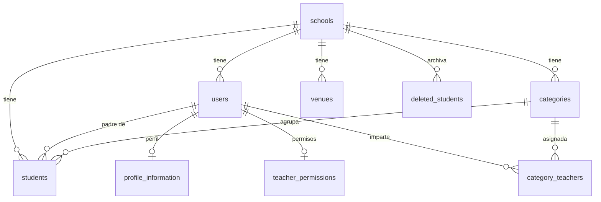
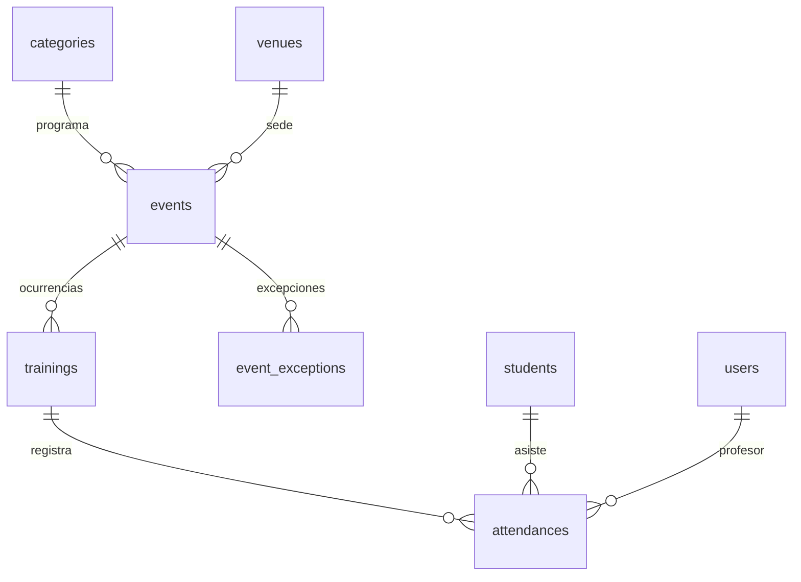
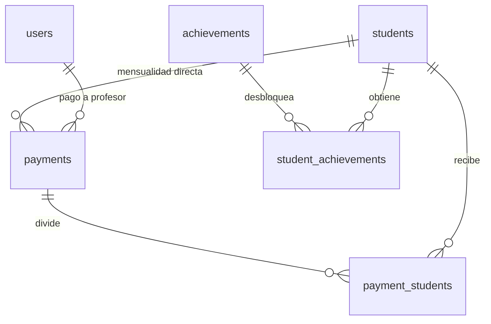

# Bóveda de la app Futcademic · 04-Datos

Notas técnicas internas de la app (Obsidian). Los [[enlaces]] apuntan a otras notas de la bóveda.

---

## Nota: Base de datos

# Base de datos

Postgres en Supabase. El backend accede con la **service key**; el navegador nunca consulta tablas de negocio directamente.

## Tamaño real

- **28 tablas**: 18 en `schema.sql` y 10 creadas por migraciones.
- Las 10 de migraciones son 4 de chat (`chat_conversations`, `chat_messages`,
  `chat_feedback`, `chat_tool_calls`) y 6 de inscripciones
  (`consent_templates`, `enrollment_invitations`, `enrollment_applications`,
  `enrollment_consents`, `enrollment_documents`, `enrollment_access_log`).
- **8 migraciones** en total. Ver [[Migraciones]].
- Listado completo y columnas: [[Tablas]] (generado).

## Convenciones

| Convención | Detalle |
|---|---|
| PK | `uuid` con `gen_random_uuid()` |
| Tenant | `school_id` en todas las tablas de negocio |
| Timestamps | `created_at timestamptz default now()` |
| Enums | `CHECK (col = ANY (ARRAY[...]))`, no tipos enum |
| Dinero | `numeric`; cuota en `categories.monthly_fee` |
| Fechas | `date` para días; `timestamptz` para auditoría |

Las tablas puente `payment_students` y `student_achievements` **no tienen `school_id`**: heredan el tenant de su padre. No filtres por `school_id` ahí.

## Invariantes

1. `users.id` = `auth.users.id`.
2. `students.id` = `users.id` para alumnos.
3. `profile_information.id` = `users.id`.
4. `students.parent_id` → `users.id` del padre.
5. `students.category_id` → `categories.id`.
6. `payments.student_id` puede ser `NULL` en pagos grupales.
7. Borrar un alumno asume cascada en asistencias/logros y pagos con `student_id = NULL`; el SQL versionado no declara `ON DELETE` (ver [[Deriva conocida]]).

## Aislamiento

`schema.sql` **no declara políticas RLS** para las 18 tablas base. Las 10 tablas
creadas por migraciones sí traen `enable row level security`
(`20261026_chat_rls.sql` y `20261026_add_enrollment_expediente.sql`), pero
**sin políticas**: con RLS activo y cero políticas nadie entra por la API de
Supabase, y el backend sigue pasando con la service key, que la ignora. Es
cierre de la puerta directa, no aislamiento por fila.

El aislamiento verificable está en el backend: `requireTenant` fija `school_id`
y cada consulta filtra por él. Ver [[Deriva conocida]] y [[Multi-tenant]].

## Grupos de tablas

| Grupo | Tablas |
|---|---|
| Academia | `schools`, `venues`, `categories`, `category_teachers` |
| Personas | `users`, `profile_information`, `students`, `deleted_students` |
| Operación | `events`, `trainings`, `event_exceptions`, `attendances` |
| Dinero | `payments`, `payment_students` |
| Gamificación | `achievements`, `student_achievements` |
| Avisos y chat | `notifications`, `chat_conversations`, `chat_messages`, `chat_feedback`, `chat_tool_calls` |
| Inscripciones | `enrollment_invitations`, `enrollment_applications`, `enrollment_consents`, `enrollment_documents`, `enrollment_access_log`, `consent_templates` |
| Permisos | `teacher_permissions` |

## Antes de tocar

- Cambios: [[Cambiar la base de datos]].
- Relaciones: [[Relaciones]].
- Deriva: [[Deriva conocida]].

---

## Nota: Deriva conocida

# Deriva conocida

Diferencias entre lo que el código escribe y lo que declaran `schema.sql` y
`migrations/*.sql`. **Antes de confiar en una columna, revisa la base real.**

## `students` y `users`: `first_name` / `last_name`

`schema.sql` solo declara `full_name` en `students` y `users`, pero el backend
escribe y lee `first_name` y `last_name`:

- `backend/api/controllers/auth.controller.ts` (registro e invitaciones)
- `backend/api/controllers/student.controller.ts` (altas y ediciones)

Las columnas existen en la base de producción (añadidas a mano), pero no hay
migración que las cree. Consecuencias:

- Un entorno nuevo creado solo con `schema.sql` + migraciones rompe el alta de
  alumnos y usuarios.
- `full_name` sigue siendo el nombre canónico para mostrar; `first_name` /
  `last_name` son un desglose que puede quedar vacío.

**Arreglo pendiente:** migración que añada las columnas y rellene el desglose a
partir de `full_name`.

## `PUT /students/:id` espera `fullName`, no `full_name`

`createStudent` lee `full_name` del body, pero `updateStudent` desestructura
`fullName` (`backend/api/controllers/student.controller.ts`). El panel mandaba
solo `full_name`, así que **renombrar a un alumno desde la ficha no guardaba
nada y la respuesta era 200**: `full_name: undefined` desaparece al serializar
el update de Supabase, de modo que ni fallaba ni escribía.

El panel manda los dos nombres desde el 27-oct
(`aPayloadAlumno` en `web/src/screens/admin/components/StudentEditForm.tsx`).

**Arreglo pendiente en el backend:** aceptar `full_name` en `updateStudent`
como hace `createStudent`, y entonces quitar el campo duplicado del panel.

## `categories.birth_year` es `text`, no `integer`

`schema.sql` lo declaraba como `integer NOT NULL`. En la base real es `text`, y
16 de las 27 categorías guardan algo que no es un año suelto: `2010-2011`,
`2012-2013-2014`, `2014-2015 Femenil`, `Porteros`, `4`.

`schema.sql` ya está corregido y el código trata la columna como la etiqueta de
la generación que es. Ver [[Modulo Categorias]]. Lo que queda abierto:

- `categories_school_id_birth_year_key`, el UNIQUE sobre `(school_id,
  birth_year)`, no estaba documentado en ningún sitio y es el que dispara el
  23505 que probaba `modular.test.ts`.
- `Alcones Rayados` tiene `Sub14` (2012) y `SUB14` (2014). Probablemente la
  primera debería llamarse `Sub12`; mientras tanto el índice único de nombre no
  se puede crear.

## `categories.horario`: columna muerta

La base tiene `categories.horario text`, que no está en `schema.sql` ni en
ninguna migración, y está vacía en las 27 filas. Ningún controlador la lee ni
la escribe. El horario real vive en `events` + `trainings`.

**Arreglo pendiente:** borrarla, o documentarla si alguien la quería para algo.

## Resuelto: `categories` (2026-10-26)

El módulo de categorías arrastraba tres desajustes que ya no existen, anotados
aquí por si aparecen en una base sin la migración `20261026_categories_module.sql`:

- El panel mandaba `teacher_id` (string) y el controlador leía `teacher_ids`
  (array): la asignación de profesores se descartaba en silencio.
- Se creyó que el formulario rompía al mandar `"2015-2016"` a `birth_year`.
  En realidad la columna es `text` y eso era lo normal; ver la sección de
  arriba.
- `teacher_permissions.can_manage_categories` se guardaba y se editaba sin que
  ninguna ruta lo consultara. Ver [[Modulo Categorias]].

Las columnas `status`, `archived_at`, `description`, `max_students` y
`updated_at` **necesitan esa migración aplicada** en el SQL
editor de Supabase antes de desplegar el backend; sin ella el listado falla con
columna inexistente.

## `students.status`: `pendiente`/`beca` vs `pendiente_pago`/`becado`

`schema.sql` declara un CHECK con `activo, beca, pendiente, inactivo`; el
controlador y la UI escriben `pendiente_pago` y `becado`. La base de producción
no tiene el CHECK, así que las escrituras funcionan, pero
`getPendingPayments` filtra por `['activo', 'pendiente']` y por eso no lista a
los alumnos en `pendiente_pago`. Resuelto el 27-oct: `schema.sql` alineado, migración `20261027_students_status_values.sql` (aplicar a mano) y fix del backend en la rama `fix/pending-payments-pendiente-pago`. Detalle en [[Modulo Alumnos]].

## Cómo evitar más deriva

1. Si tocas una tabla, añade la columna a `schema.sql` o a una migración fechada
   (`YYYYMMDD_descripcion.sql`), nunca solo al código.
2. Las migraciones se aplican a mano en el SQL editor de Supabase, en orden de
   nombre; no hay runner que detecte una migración olvidada.
3. Si una nota contradice al código, gana el código: corrige la nota en el
   mismo cambio. Ver [[Tablas]].

---

## Nota: Migraciones

# Migraciones

## Inventario

| Archivo | Qué hace |
|---|---|
| `20260511_add_financial_fields.sql` | `categories.monthly_fee`, `payments.payment_year`; backfill del año; comentarios |
| `20260512_add_user_onboarded_at.sql` | `users.onboarded_at` para el onboarding de profesor |
| `20260512_add_username_to_users.sql` | `users.username` + índice único `(school_id, username)` para login de alumno |
| `20260709_add_chat_tables.sql` | `chat_conversations`, `chat_messages` + índices |

## Cómo se aplican

No hay runner. Se pegan en el **SQL Editor de Supabase**, en orden de nombre:

1. `schema.sql` (instalación nueva).
2. Migraciones `YYYYMMDD_*` de la más vieja a la más nueva.

> [!warning] `schema.sql` se contradice
> Su primera línea dice "not meant to be run", pero el onboarding del repo indica aplicarlo primero. En una instalación nueva, verifica el orden y prueba contra una base vacía antes de confiar. Ver [[Deriva conocida]].

## Reglas para una migración nueva

1. Nombre `YYYYMMDD_descripcion.sql`.
2. Idempotente: `ADD COLUMN IF NOT EXISTS`, `CREATE TABLE IF NOT EXISTS`, `CREATE INDEX IF NOT EXISTS`.
3. No romper datos existentes: agregar nullable o con `DEFAULT`, luego backfill, luego constraint.
4. Actualizar `schema.sql` si el cambio debe existir en instalaciones nuevas.
5. Actualizar `docs/technical/DATABASE-SCHEMA.md` y `ESQUEMA-BASE-DATOS.md` (par EN/ES).
6. Regenerar la bóveda: `python3 scripts/vault/vault.py generar`.
7. Probar el endpoint afectado.

## Orden seguro en producción

```text
1. Aplicar migración (aditiva, compatible hacia atrás)
2. Desplegar backend que la usa
3. Verificar
4. Limpiar columnas viejas en una migración posterior
```

Nunca al revés: el código nuevo no debe llegar antes que la columna.

## Dónde mirar

- Columnas resultantes: [[Tablas]].
- Deriva entre SQL y código: [[Deriva conocida]].
- Procedimiento completo: [[Cambiar la base de datos]].

---

## Nota: Relaciones

# Relaciones

Diagramas de las relaciones que usa el código. Las columnas exactas están en [[Tablas]].

> [!note] Cardinalidad simplificada
> Varias FK son nullable: `students.parent_id`, `attendances.training_id` y `payments.student_id` (pago grupal). Los diagramas muestran la relación típica, no la obligatoriedad.

## Academia y personas



- `students.id` es también `users.id` cuando el alumno tiene cuenta.
- `deleted_students` guarda una copia antes del borrado permanente.

## Operación



- `events` es la serie; `trainings` la ocurrencia con fecha.
- `attendances.training_id` puede ser `NULL` (pase de lista sin sesión vinculada).

## Dinero y logros



- `payments.student_id` es `NULL` en un pago grupal; el reparto vive en `payment_students`.
- `payment_students` y `student_achievements` no tienen `school_id`.

## Lectura rápida

| Pregunta | Ruta |
|---|---|
| ¿Quién es el padre de este alumno? | `students.parent_id → users.id` |
| ¿Qué sesión generó esta asistencia? | `attendances.training_id → trainings.id` |
| ¿Qué evento genera estas sesiones? | `trainings.event_id → events.id` |
| ¿Cómo se repartió un pago grupal? | `payment_students` |
| ¿Qué logros tiene un alumno? | `student_achievements` |

---

## Nota: Tablas

<!-- No editar a mano: python3 scripts/vault/vault.py generar -->

# Tablas

Esquema leído de `schema.sql` más las columnas añadidas por `migrations/*.sql`.

- **28 tablas**, **315 columnas**.
- `schema.sql` es la base; las migraciones se aplican después, en orden de nombre.

> [!warning] Deriva conocida
> El backend escribe columnas que no están en `schema.sql` ni en las migraciones (`first_name`, `last_name`, …). Antes de confiar en una columna, revisa [[Deriva conocida]].

## Tablas

[[#achievements]] · [[#attendances]] · [[#categories]] · [[#category_teachers]] · [[#chat_conversations]] · [[#chat_feedback]] · [[#chat_messages]] · [[#chat_tool_calls]] · [[#consent_templates]] · [[#deleted_students]] · [[#enrollment_access_log]] · [[#enrollment_applications]] · [[#enrollment_consents]] · [[#enrollment_documents]] · [[#enrollment_invitations]] · [[#event_exceptions]] · [[#events]] · [[#notifications]] · [[#payment_students]] · [[#payments]] · [[#profile_information]] · [[#schools]] · [[#student_achievements]] · [[#students]] · [[#teacher_permissions]] · [[#trainings]] · [[#users]] · [[#venues]]

## achievements

`schema.sql` · 8 columnas

| Columna | Tipo | Notas |
| --- | --- | --- |
| `id` | `uuid` | NOT NULL, default `gen_random_uuid()` |
| `school_id` | `uuid` | FK → `schools.id`, NOT NULL |
| `name` | `character varying` | NOT NULL |
| `description` | `text` | — |
| `icon` | `character varying` | — |
| `type` | `character varying` | NOT NULL, enum: racha, asistencias, goles, puntualidad, progreso |
| `threshold` | `integer` | NOT NULL |
| `created_at` | `timestamp with time zone` | default `now()` |

## attendances

`schema.sql` · 10 columnas

| Columna | Tipo | Notas |
| --- | --- | --- |
| `id` | `uuid` | NOT NULL, default `gen_random_uuid()` |
| `school_id` | `uuid` | FK → `schools.id`, NOT NULL |
| `student_id` | `uuid` | FK → `students.id`, NOT NULL |
| `category_id` | `uuid` | FK → `categories.id`, NOT NULL |
| `teacher_id` | `uuid` | FK → `users.id` |
| `training_id` | `uuid` | FK → `trainings.id` |
| `date` | `date` | NOT NULL |
| `type` | `character varying` | enum: entrenamiento, partido |
| `present` | `boolean` | NOT NULL, default `false` |
| `created_at` | `timestamp with time zone` | default `now()` |

## categories

`schema.sql` · 12 columnas

| Columna | Tipo | Notas |
| --- | --- | --- |
| `id` | `uuid` | NOT NULL, default `gen_random_uuid()` |
| `school_id` | `uuid` | FK → `schools.id`, NOT NULL |
| `birth_year` | `text` | NOT NULL |
| `name` | `character varying` | NOT NULL |
| `description` | `text` | — |
| `color` | `character varying` | — |
| `monthly_fee` | `numeric` | default `0` |
| `max_students` | `integer` | — |
| `status` | `character varying` | NOT NULL, default `'activa'` |
| `archived_at` | `timestamp with time zone` | — |
| `created_at` | `timestamp with time zone` | default `now()` |
| `updated_at` | `timestamp with time zone` | default `now()` |

## category_teachers

`schema.sql` · 5 columnas

| Columna | Tipo | Notas |
| --- | --- | --- |
| `id` | `uuid` | NOT NULL, default `gen_random_uuid()` |
| `school_id` | `uuid` | FK → `schools.id`, NOT NULL |
| `category_id` | `uuid` | FK → `categories.id`, NOT NULL |
| `teacher_id` | `uuid` | FK → `users.id`, NOT NULL |
| `created_at` | `timestamp with time zone` | default `now()` |

## chat_conversations

`migrations/20260709_add_chat_tables.sql` · 8 columnas

| Columna | Tipo | Notas |
| --- | --- | --- |
| `id` | `uuid primary key` | default `gen_random_uuid()` |
| `school_id` | `uuid` | NOT NULL |
| `user_id` | `uuid` | NOT NULL |
| `title` | `text` | — |
| `status` | `text` | NOT NULL |
| `pending_state` | `jsonb,                   -- estado del loop pausado esperando confirmación` | — |
| `created_at` | `timestamptz` | NOT NULL, default `now()` |
| `updated_at` | `timestamptz` | NOT NULL, default `now()` |

## chat_feedback

`migrations/20261026_chat_feedback_and_tool_calls.sql` · 11 columnas

| Columna | Tipo | Notas |
| --- | --- | --- |
| `id` | `uuid primary key` | default `gen_random_uuid()` |
| `school_id` | `uuid` | NOT NULL |
| `user_id` | `uuid` | NOT NULL |
| `conversation_id` | `uuid` | NOT NULL |
| `message_id` | `uuid` | NOT NULL |
| `rating` | `text` | NOT NULL, check `rating in ('up', 'down')` |
| `reason` | `text,          -- motivo del 👎: 'datos_incorrectos', 'no_era_eso', ...` | — |
| `comment` | `text` | — |
| `created_at` | `timestamptz` | NOT NULL, default `now()` |
| `updated_at` | `timestamptz` | NOT NULL, default `now()` |
| `unique` | `(message_id, user_id)` | — |

## chat_messages

`migrations/20260709_add_chat_tables.sql` · 5 columnas

| Columna | Tipo | Notas |
| --- | --- | --- |
| `id` | `uuid primary key` | default `gen_random_uuid()` |
| `conversation_id` | `uuid` | NOT NULL |
| `role` | `text` | NOT NULL |
| `content` | `jsonb` | NOT NULL |
| `created_at` | `timestamptz` | NOT NULL, default `now()` |

## chat_tool_calls

`migrations/20261026_chat_feedback_and_tool_calls.sql` · 11 columnas

| Columna | Tipo | Notas |
| --- | --- | --- |
| `id` | `uuid primary key` | default `gen_random_uuid()` |
| `school_id` | `uuid` | NOT NULL |
| `conversation_id` | `uuid` | NOT NULL |
| `tool_name` | `text` | NOT NULL |
| `input` | `jsonb` | NOT NULL, default `'{}'::jsonb` |
| `ok` | `boolean` | NOT NULL |
| `is_sensitive` | `boolean` | NOT NULL, default `false` |
| `confirmed` | `boolean` | — |
| `duration_ms` | `integer` | — |
| `error` | `text` | — |
| `created_at` | `timestamptz` | NOT NULL, default `now()` |

## consent_templates

`migrations/20261026_add_enrollment_expediente.sql` · 8 columnas

| Columna | Tipo | Notas |
| --- | --- | --- |
| `id` | `uuid primary key` | default `gen_random_uuid()` |
| `school_id` | `uuid` | — |
| `version` | `text` | NOT NULL |
| `body_md` | `text` | NOT NULL |
| `body_hash` | `text` | — |
| `active` | `boolean` | NOT NULL, default `true` |
| `created_by` | `uuid` | — |
| `created_at` | `timestamptz` | NOT NULL, default `now()` |

## deleted_students

`schema.sql` · 9 columnas

| Columna | Tipo | Notas |
| --- | --- | --- |
| `id` | `uuid` | NOT NULL, default `gen_random_uuid()` |
| `school_id` | `uuid` | FK → `schools.id`, NOT NULL |
| `original_student_id` | `uuid` | NOT NULL |
| `full_name` | `character varying` | NOT NULL |
| `birth_date` | `date` | NOT NULL |
| `category_id` | `uuid` | — |
| `parent_id` | `uuid` | — |
| `deleted_at` | `timestamp with time zone` | default `now()` |
| `deleted_by` | `uuid` | FK → `users.id` |

## enrollment_access_log

`migrations/20261026_add_enrollment_expediente.sql` · 11 columnas

| Columna | Tipo | Notas |
| --- | --- | --- |
| `id` | `uuid primary key` | default `gen_random_uuid()` |
| `school_id` | `uuid` | NOT NULL |
| `invitation_id` | `uuid` | — |
| `user_id` | `uuid` | — |
| `action` | `text` | NOT NULL |
| `entity_type` | `text` | — |
| `entity_id` | `uuid` | — |
| `ip` | `inet` | — |
| `user_agent` | `text` | — |
| `metadata` | `jsonb` | — |
| `created_at` | `timestamptz` | NOT NULL, default `now()` |

## enrollment_applications

`migrations/20261026_add_enrollment_expediente.sql` · 32 columnas

| Columna | Tipo | Notas |
| --- | --- | --- |
| `id` | `uuid primary key` | default `gen_random_uuid()` |
| `school_id` | `uuid` | NOT NULL |
| `invitation_id` | `uuid` | NOT NULL |
| `category_id` | `uuid` | NOT NULL |
| `original_category_id` | `uuid` | — |
| `status` | `text` | NOT NULL, default `'borrador'` |
| `check` | `(status in ('borrador', 'enviada', 'en_revision', 'aprobada', 'rechazada'))` | — |
| `student_full_name` | `text` | — |
| `student_birth_date` | `date` | — |
| `student_curp` | `text` | — |
| `student_phone` | `text` | — |
| `student_address` | `text` | — |
| `emergency_contact_name` | `text` | — |
| `emergency_contact_phone` | `text` | — |
| `medical_notes` | `text` | — |
| `guardian_full_name` | `text` | — |
| `guardian_relationship` | `text` | — |
| `guardian_email` | `text` | — |
| `guardian_phone` | `text` | — |
| `guardian_address` | `text` | — |
| `guardian_user_id` | `uuid` | — |
| `submitted_at` | `timestamptz` | — |
| `submitted_ip` | `inet` | — |
| `submitted_user_agent` | `text` | — |
| `reviewed_by` | `uuid` | — |
| `reviewed_at` | `timestamptz` | — |
| `rejection_reason` | `text` | — |
| `student_id` | `uuid` | — |
| `category_mismatch` | `boolean` | NOT NULL, default `false` |
| `reopen_count` | `integer` | NOT NULL, default `0` |
| `created_at` | `timestamptz` | NOT NULL, default `now()` |
| `updated_at` | `timestamptz` | NOT NULL, default `now()` |

## enrollment_consents

`migrations/20261026_add_enrollment_expediente.sql` · 20 columnas

| Columna | Tipo | Notas |
| --- | --- | --- |
| `id` | `uuid primary key` | default `gen_random_uuid()` |
| `school_id` | `uuid` | NOT NULL |
| `application_id` | `uuid unique` | — |
| `student_id` | `uuid` | — |
| `guardian_name` | `text` | NOT NULL |
| `guardian_relationship` | `text` | — |
| `consent_version` | `text` | NOT NULL |
| `text_hash` | `text` | NOT NULL |
| `accepted_data` | `boolean` | NOT NULL, default `false` |
| `accepted_participation` | `boolean` | NOT NULL, default `false` |
| `accepted_medical` | `boolean` | NOT NULL, default `false` |
| `accepted_image` | `boolean` | NOT NULL, default `false` |
| `accepted_at` | `timestamptz` | NOT NULL, default `now()` |
| `ip` | `inet` | — |
| `user_agent` | `text` | — |
| `pdf_path` | `text` | — |
| `captured_by` | `uuid` | — |
| `revoked_at` | `timestamptz` | — |
| `created_at` | `timestamptz` | NOT NULL, default `now()` |
| `or` | `(application_id is null and student_id is` | NOT NULL |

## enrollment_documents

`migrations/20261026_add_enrollment_expediente.sql` · 22 columnas

| Columna | Tipo | Notas |
| --- | --- | --- |
| `id` | `uuid primary key` | default `gen_random_uuid()` |
| `school_id` | `uuid` | NOT NULL |
| `application_id` | `uuid` | — |
| `student_id` | `uuid` | — |
| `owner_type` | `text` | NOT NULL, check `owner_type in ('alumno', 'tutor')` |
| `doc_type` | `text` | NOT NULL |
| `file_path` | `text` | NOT NULL |
| `file_name` | `text` | — |
| `mime_type` | `text` | — |
| `size_bytes` | `bigint` | — |
| `file_hash` | `text` | — |
| `status` | `text` | NOT NULL, default `'pendiente'` |
| `check` | `(status in ('pendiente', 'validado', 'rechazado', 'vencido'))` | — |
| `expires_at` | `date` | — |
| `uploaded_by` | `uuid` | — |
| `uploaded_at` | `timestamptz` | NOT NULL, default `now()` |
| `verified_by` | `uuid` | — |
| `verified_at` | `timestamptz` | — |
| `rejection_reason` | `text` | — |
| `reused_from` | `uuid` | — |
| `created_at` | `timestamptz` | NOT NULL, default `now()` |
| `or` | `(application_id is null and student_id is` | NOT NULL |

## enrollment_invitations

`migrations/20261026_add_enrollment_expediente.sql` · 11 columnas

| Columna | Tipo | Notas |
| --- | --- | --- |
| `id` | `uuid primary key` | default `gen_random_uuid()` |
| `school_id` | `uuid` | NOT NULL |
| `category_id` | `uuid` | NOT NULL |
| `token_hash` | `text` | NOT NULL |
| `created_by` | `uuid` | — |
| `expires_at` | `timestamptz` | NOT NULL |
| `used_at` | `timestamptz` | — |
| `revoked_at` | `timestamptz` | — |
| `application_id` | `uuid` | — |
| `note` | `text` | — |
| `created_at` | `timestamptz` | NOT NULL, default `now()` |

## event_exceptions

`schema.sql` · 6 columnas

| Columna | Tipo | Notas |
| --- | --- | --- |
| `id` | `uuid` | NOT NULL, default `uuid_generate_v4()` |
| `school_id` | `uuid` | FK → `schools.id` |
| `event_id` | `uuid` | FK → `events.id` |
| `date` | `date` | NOT NULL |
| `is_cancelled` | `boolean` | default `true` |
| `created_at` | `timestamp with time zone` | default `now()` |

## events

`schema.sql` · 14 columnas

| Columna | Tipo | Notas |
| --- | --- | --- |
| `id` | `uuid` | NOT NULL, default `gen_random_uuid()` |
| `school_id` | `uuid` | FK → `schools.id`, NOT NULL |
| `category_id` | `uuid` | FK → `categories.id`, NOT NULL |
| `venue_id` | `uuid` | FK → `venues.id` |
| `date` | `date` | NOT NULL |
| `start_time` | `time without time zone` | — |
| `type` | `character varying` | enum: entrenamiento, partido |
| `description` | `text` | — |
| `is_completed` | `boolean` | default `false` |
| `is_recurring` | `boolean` | default `false` |
| `recurring_weeks` | `integer` | — |
| `recurring_end_date` | `date` | — |
| `recurrence_rule` | `jsonb` | — |
| `created_at` | `timestamp with time zone` | default `now()` |

## notifications

`schema.sql` · 9 columnas

| Columna | Tipo | Notas |
| --- | --- | --- |
| `id` | `uuid` | NOT NULL, default `gen_random_uuid()` |
| `school_id` | `uuid` | FK → `schools.id`, NOT NULL |
| `user_id` | `uuid` | FK → `users.id`, NOT NULL |
| `title` | `character varying` | NOT NULL |
| `body` | `text` | — |
| `type` | `character varying` | NOT NULL, enum: pago_recibido, sesion_recordatorio, sesion_cancelada, bienvenida, logro_desbloqueado |
| `data` | `jsonb` | — |
| `is_read` | `boolean` | default `false` |
| `created_at` | `timestamp with time zone` | default `now()` |

## payment_students

`schema.sql` · 5 columnas

| Columna | Tipo | Notas |
| --- | --- | --- |
| `id` | `uuid` | NOT NULL, default `gen_random_uuid()` |
| `payment_id` | `uuid` | FK → `payments.id`, NOT NULL |
| `student_id` | `uuid` | FK → `students.id`, NOT NULL |
| `amount` | `numeric` | NOT NULL |
| `created_at` | `timestamp with time zone` | default `now()` |

## payments

`schema.sql` · 11 columnas

| Columna | Tipo | Notas |
| --- | --- | --- |
| `id` | `uuid` | NOT NULL, default `gen_random_uuid()` |
| `school_id` | `uuid` | FK → `schools.id`, NOT NULL |
| `amount` | `numeric` | NOT NULL |
| `payment_date` | `date` | NOT NULL |
| `payment_type` | `character varying` | enum: mensualidad, pago_profesor |
| `student_id` | `uuid` | FK → `students.id` |
| `teacher_id` | `uuid` | FK → `users.id` |
| `description` | `text` | — |
| `payment_month` | `integer` | — |
| `payment_year` | `integer` | default `extract(year from now())` |
| `created_at` | `timestamp with time zone` | default `now()` |

## profile_information

`schema.sql` · 11 columnas

| Columna | Tipo | Notas |
| --- | --- | --- |
| `id` | `uuid` | FK → `users.id`, NOT NULL |
| `school_id` | `uuid` | FK → `schools.id`, NOT NULL |
| `phone` | `character varying` | — |
| `address` | `text` | — |
| `birth_date` | `date` | — |
| `gender` | `character varying` | — |
| `emergency_contact_name` | `character varying` | — |
| `emergency_contact_phone` | `character varying` | — |
| `medical_notes` | `text` | — |
| `avatar_url` | `text` | — |
| `updated_at` | `timestamp with time zone` | default `now()` |

## schools

`schema.sql` · 7 columnas

| Columna | Tipo | Notas |
| --- | --- | --- |
| `id` | `uuid` | NOT NULL, default `gen_random_uuid()` |
| `name` | `character varying` | NOT NULL |
| `logo_url` | `text` | — |
| `razon_social` | `character varying` | — |
| `direccion` | `text` | — |
| `contacto_email` | `character varying` | — |
| `created_at` | `timestamp with time zone` | default `now()` |

## student_achievements

`schema.sql` · 4 columnas

| Columna | Tipo | Notas |
| --- | --- | --- |
| `id` | `uuid` | NOT NULL, default `gen_random_uuid()` |
| `student_id` | `uuid` | FK → `students.id`, NOT NULL |
| `achievement_id` | `uuid` | FK → `achievements.id`, NOT NULL |
| `unlocked_at` | `timestamp with time zone` | default `now()` |

## students

`schema.sql` · 20 columnas

| Columna | Tipo | Notas |
| --- | --- | --- |
| `id` | `uuid` | NOT NULL, default `gen_random_uuid()` |
| `school_id` | `uuid` | FK → `schools.id`, NOT NULL |
| `category_id` | `uuid` | FK → `categories.id`, NOT NULL |
| `parent_id` | `uuid` | FK → `users.id` |
| `full_name` | `character varying` | NOT NULL |
| `birth_date` | `date` | NOT NULL |
| `status` | `character varying` | default `'activo'::character varying`, enum: activo, pendiente_pago, becado, inactivo |
| `uniform_delivered` | `boolean` | default `false` |
| `phone` | `character varying` | — |
| `address` | `text` | — |
| `emergency_contact_name` | `character varying` | — |
| `emergency_contact_phone` | `character varying` | — |
| `medical_notes` | `text` | — |
| `avatar_url` | `text` | — |
| `current_streak` | `integer` | default `0` |
| `max_streak` | `integer` | default `0` |
| `last_attendance_date` | `date` | — |
| `created_at` | `timestamp with time zone` | default `now()` |
| `curp` | `text` | migración `20261026_add_enrollment_expediente.sql` |
| `guardian_relationship` | `text` | migración `20261026_add_enrollment_expediente.sql` |

## teacher_permissions

`schema.sql` · 10 columnas

| Columna | Tipo | Notas |
| --- | --- | --- |
| `id` | `uuid` | NOT NULL, default `gen_random_uuid()` |
| `school_id` | `uuid` | FK → `schools.id`, NOT NULL |
| `teacher_id` | `uuid` | FK → `users.id`, NOT NULL |
| `can_manage_students` | `boolean` | default `true` |
| `can_manage_events` | `boolean` | default `true` |
| `can_view_finances` | `boolean` | default `false` |
| `can_manage_payments` | `boolean` | default `false` |
| `can_take_attendance` | `boolean` | default `true` |
| `can_manage_categories` | `boolean` | default `false` |
| `created_at` | `timestamp with time zone` | default `now()` |

## trainings

`schema.sql` · 11 columnas

| Columna | Tipo | Notas |
| --- | --- | --- |
| `id` | `uuid` | NOT NULL, default `gen_random_uuid()` |
| `school_id` | `uuid` | FK → `schools.id` |
| `event_id` | `uuid` | FK → `events.id` |
| `category_id` | `uuid` | FK → `categories.id` |
| `venue_id` | `uuid` | FK → `venues.id` |
| `date` | `date` | NOT NULL |
| `start_time` | `time without time zone` | — |
| `type` | `character varying` | enum: entrenamiento, partido |
| `is_completed` | `boolean` | default `false` |
| `is_cancelled` | `boolean` | default `false` |
| `created_at` | `timestamp with time zone` | default `now()` |

## users

`schema.sql` · 15 columnas

| Columna | Tipo | Notas |
| --- | --- | --- |
| `id` | `uuid` | NOT NULL |
| `school_id` | `uuid` | FK → `schools.id` |
| `role` | `character varying` | enum: super_admin, admin, profesor, padre, alumno |
| `full_name` | `character varying` | NOT NULL |
| `avatar_url` | `text` | — |
| `must_change_password` | `boolean` | NOT NULL, default `false` |
| `push_token` | `text` | — |
| `phone` | `character varying` | — |
| `address` | `text` | — |
| `apodo` | `character varying` | — |
| `numero_favorito` | `integer` | — |
| `posicion` | `character varying` | — |
| `created_at` | `timestamp with time zone` | default `now()` |
| `onboarded_at` | `TIMESTAMPTZ` | migración `20260512_add_user_onboarded_at.sql` |
| `username` | `TEXT` | migración `20260512_add_username_to_users.sql` |

## venues

`schema.sql` · 9 columnas

| Columna | Tipo | Notas |
| --- | --- | --- |
| `id` | `uuid` | NOT NULL, default `gen_random_uuid()` |
| `school_id` | `uuid` | FK → `schools.id`, NOT NULL |
| `name` | `character varying` | NOT NULL |
| `address` | `text` | — |
| `notes` | `text` | — |
| `capacity` | `integer` | — |
| `latitud` | `numeric` | — |
| `longitud` | `numeric` | — |
| `created_at` | `timestamp with time zone` | default `now()` |
