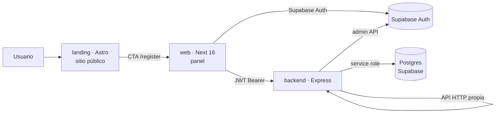
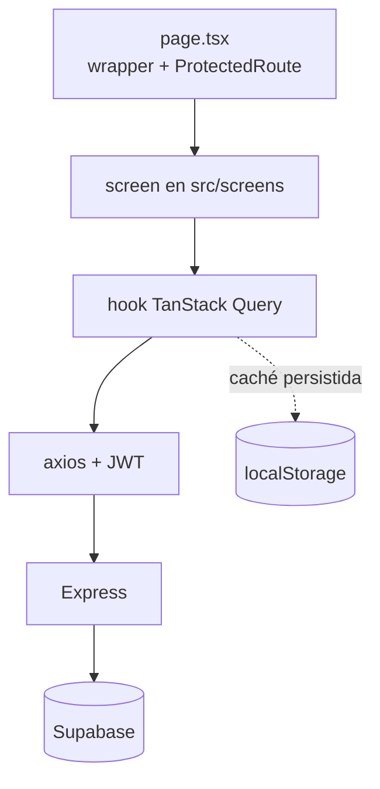

# Arquitectura

## Cuatro piezas



- **`landing/`** es estático: no lee Supabase ni la API. Solo enlaza al registro.
- **`web/`** es una SPA en la práctica: todo es cliente, sin SSR de datos.
- **`backend/`** es la única pieza con la `service role`; nunca se expone al navegador.
- **Supabase** hace dos trabajos: autenticación y Postgres.

## Ciclo de una petición

```text
Navegador
  → hook TanStack Query (web/src/hooks)
  → axios con interceptor JWT (web/src/api/axios.ts)
  → Express
      app.ts: CORS + JSON 1 MB + /api/health
      routes/index.ts: monta 17 routers
      requireAuth      → valida el Bearer con Supabase
      requireTenant    → lee users y fija { school_id, role, user_id }
      requireRole(...) → comprueba rol
      controller       → supabaseAdmin (service role)
  ← JSON (errores en español)
```

El detalle de los middlewares está en [[Middlewares y autenticacion]]; el aislamiento, en [[Multi-tenant]].

## Flujo de datos del panel



- `app/**/page.tsx` solo declara roles y monta la pantalla. Ver [[Rutas web]].
- La caché de consultas se persiste y se invalida con `NEXT_PUBLIC_BUILD_ID`.
- Auth de usuario vive en `AuthContext` (Supabase directo). El resto de datos pasa por hooks → axios.

## Autenticación vs. autorización

| Capa | Quién | Qué valida |
|---|---|---|
| Supabase Auth | navegador | email/usuario y contraseña; emite JWT |
| `requireAuth` | backend | que el JWT sea válido |
| `requireTenant` | backend | que exista fila en `users`; de ahí salen `school_id` y `role` |
| `requireRole` | backend | rol declarado por ruta |
| `findStudentForTenant` | backend | que el alumno pertenezca al tenant/usuario correcto |
| `ProtectedRoute` | web | rol para mostrar la pantalla (cosmético, no seguridad) |

## Chat IA

Ruta aparte, solo admin: SSE + loop Anthropic que ejecuta *tools* contra la propia API reutilizando el token del admin. Ver [[Chat IA]].

## Decisiones que sorprenden

1. **No hay SSR de datos**: el panel es cliente puro; `queryClient` usa storage no-op en servidor para hidratar igual.
2. **La PWA no depende de ningún plugin**: `public/sw.js` está escrito a mano y solo se registra en producción; la sesión sin conexión se lee de localStorage porque `getSession()` falla sin red. Ver [[Convenciones web]].
3. **`dist/` se commitea** en el repo del backend.
4. **`backend/` y `mobile/` son repos separados**; el raíz no los ve.
5. **`schema.sql` no declara RLS**; el aislamiento verificable está en el backend. Ver [[Deriva conocida]].
6. **`schema.sql` se describe a sí mismo como "no ejecutable"**; aun así es la base documental. Ver [[Deriva conocida]].
