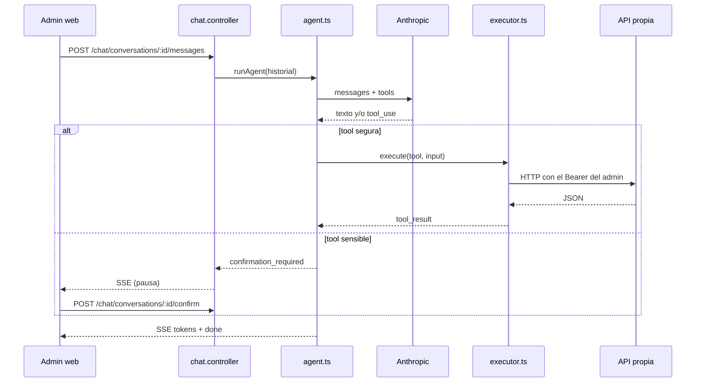

# Chat IA - backend

## Qué es

Asistente para **admins** que responde en streaming (SSE) y puede **ejecutar acciones** sobre la API: listar alumnos, crear eventos, registrar pagos, borrar alumnos, invitar usuarios.

- Modelo: `claude-haiku-4-5`.
- Loop manual de Anthropic, máximo **15 iteraciones**.
- 34 *tools* declaradas; cada una apunta a un endpoint real del backend.
- Solo `super_admin` y `admin` (`router.use(... requireRole(...))`).
- El mensaje puede llevar `context` (pantalla abierta, registro en foco y
  filtros): el agente lo recibe en un bloque de sistema aparte y sin
  `cache_control` (ver [[Chat IA#Contexto de pantalla]]).

## Flujo



## Tools sensibles

Marcadas con `sensitive: true` en `tools.ts`: pagos, bajas de alumno, invitaciones y otras escrituras destructivas. El agente **no las ejecuta**: emite `confirmation_required`, guarda el estado en `chat_conversations.pending_state` y espera `POST /conversations/:id/confirm`.

Las tools llaman a la API con el **mismo token del admin**, así que no pueden hacer más de lo que ese admin ya puede hacer. `chat-tools.test.ts` verifica que las 34 apunten a endpoints existentes y respeten roles.

## Endpoints

| Endpoint | Uso |
|---|---|
| `GET /chat/conversations` | historial |
| `GET /chat/conversations/:id/messages` | mensajes |
| `POST /chat/conversations/:id/messages` | enviar; responde SSE |
| `POST /chat/conversations/:id/confirm` | aprobar/rechazar acciones |
| `DELETE /chat/conversations/:id` | borrar conversación |

## Archivos

| Archivo | Responsabilidad |
|---|---|
| `agent.ts` | loop, ensamblado del sistema y pausa por confirmación |
| `prompt.ts` | prompt de sistema (reutilizado por producción y evaluación) |
| `screen-context.ts` | saneado del contexto de pantalla y bloque de prompt |
| `eval-scoring.ts` | puntuación determinista del set de evaluación |
| `tools.ts` | definiciones JSON Schema + `SENSITIVE_TOOLS` |
| `executor.ts` | traduce tool → llamada HTTP interna |
| `store.ts` | conversaciones y mensajes en Supabase |
| `sse.ts` | eventos SSE |

## Evaluación

`scripts/eval-chat.ts` mide la capa del modelo **sin ejecutar herramientas**:
elige la herramienta correcta y evita las peligrosas. Reutiliza `prompt.ts` y
las 34 tools reales; los 38 casos viven en `scripts/eval/cases.json` y la
puntuación (`any_of`, `all_of`, `none_of`, `no_tools`, `arg`) en
`eval-scoring.ts`.

```bash
cd backend
npm run eval:chat                          # set completo
npm run eval:chat -- --category cobranza   # una categoría
npm run eval:chat -- --model otro-modelo   # comparar proveedores
```

Línea base: **38/38** con `claude-haiku-4-5`. El informe queda en
`scripts/eval/last-run.json` (ignorado por Git).

## Tablas

`chat_conversations` (`status`: `active` \| `awaiting_confirmation`, `pending_state` jsonb) y `chat_messages` (`content` jsonb con bloques exactos de Anthropic, `context` jsonb con la pantalla que acompañó al mensaje). Se crean en `migrations/20260709_add_chat_tables.sql`; el contexto se añade en `migrations/20261026_chat_message_context.sql`.

[[Tablas#chat_conversations]] · [[Tablas#chat_messages]]

## En la web

- `web/src/contexts/ChatContext.tsx`: estado compartido, queries de conversaciones y stream SSE (`runStream`).
- `web/src/hooks/useChat.ts` solo reexporta ese contexto.
- `web/src/lib/chatScreen.ts`: contexto genérico derivado de la ruta.
- `web/src/contexts/ChatScreenContext.ts`: registro del registro en foco desde
  las fichas de alumno, profesor, categoría y Finanzas.
- El widget flotante y `/admin/chat` comparten conversación activa y stream.

Pantalla: [[Pantallas]] (`/admin/chat`). Configuración: `ANTHROPIC_API_KEY` e `INTERNAL_API_URL`.
