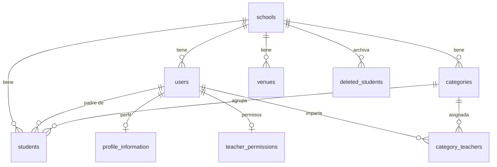
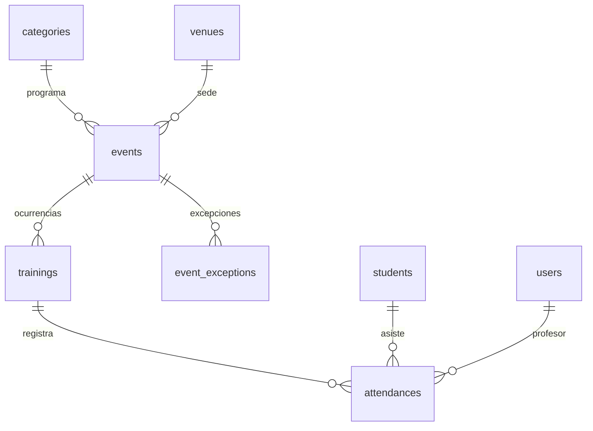
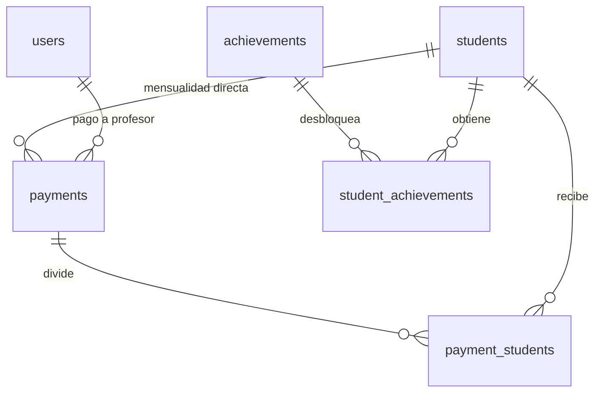

# Relaciones

Diagramas de las relaciones que usa el código. Las columnas exactas están en [[Tablas]].

> [!note] Cardinalidad simplificada
> Varias FK son nullable: `students.parent_id`, `attendances.training_id` y `payments.student_id` (pago grupal). Los diagramas muestran la relación típica, no la obligatoriedad.

## Academia y personas

- `students.id` es también `users.id` cuando el alumno tiene cuenta.
- `deleted_students` guarda una copia antes del borrado permanente.

## Operación

- `events` es la serie; `trainings` la ocurrencia con fecha.
- `attendances.training_id` puede ser `NULL` (pase de lista sin sesión vinculada).

## Dinero y logros

- `payments.student_id` es `NULL` en un pago grupal; el reparto vive en `payment_students`.
- `payment_students` y `student_achievements` no tienen `school_id`.

## Lectura rápida

| Pregunta | Ruta |
|---|---|
| ¿Quién es el padre de este alumno? | `students.parent_id → users.id` |
| ¿Qué sesión generó esta asistencia? | `attendances.training_id → trainings.id` |
| ¿Qué evento genera estas sesiones? | `trainings.event_id → events.id` |
| ¿Cómo se repartió un pago grupal? | `payment_students` |
| ¿Qué logros tiene un alumno? | `student_achievements` |
